# 🪔 Pujo Atlas — West Bengal Durga Puja Crawler & REST API

<div align="center">

[](https://python.org)
[](https://fastapi.tiangolo.com)
[](https://www.sqlalchemy.org/)
[-10b981?style=for-the-badge&logo=pytest&logoColor=white)](#testing--verification)
[-f59e0b?style=for-the-badge)](#statewide-coverage-17-districts)
[](#24-hour-periodic-background-scheduler)
[](LICENSE)

**An autonomous multi-source web crawler, consensus classification engine, and high-performance REST API cataloging Durga Puja pandals across Kolkata and all 17 districts of West Bengal.**

[Explore Dashboard](http://localhost:8000/) • [Swagger Docs](http://localhost:8000/docs) • [Architecture](#system-architecture) • [API Reference](#api-reference) • [AAS Skills](#agentic-awesome-skills-aas-integration)

</div>

---

## 🌟 Overview

**Pujo Atlas** solves the challenge of discovering and categorizing Durga Puja pandals across West Bengal by crawling multiple heterogeneous data sources and cross-referencing citations through an automated consensus algorithm.

The system catalogs and differentiates between:
- 🔥 **Popular Mega-Themes**: Towering high-budget landmarks, award winners, and massive crowd-pullers (*Sreebhumi, Bagbazar, Santosh Mitra Square, Kalyani ITI More, Sealdah Durga Bari*).
- 🕊️ **Quiet Neighborhood ("Para") Samitis**: Intimate residential celebrations with minimal queues, authentic dhaak, and local community pushpanjali (*Ahiritola Jubak Brinda, Hatkhola Gosaipara, Brindaban Matri Mandir*).
- 🏛️ **Centuries-Old Bonedi Baris**: Ancestral aristocratic household and royal pujas (*Sovabazar Rajbari, Sabarna Roy Choudhury, Bishnupur Mrinmoyee Royal Puja, Guptipara Barowari*).

---

## 🏗️ System Architecture

```mermaid
flowchart TD
    subgraph S["Heterogeneous Ingestion Sources"]
        S1["Open Geospatial Catalogs<br/>(PujoPoth / Pujo Atlas)"]
        S2["Wikipedia Heritage Archives<br/>(Barowari & UNESCO History)"]
        S3["Social Media Discussions<br/>(r/kolkata & Community Recommendations)"]
        S4["Transit & Metro Guides<br/>(Railway & Metro Confluences)"]
        S5["Neighborhood Para Registry<br/>(Local Community Clubs)"]
        S6["Statewide District Scraper<br/>(17+ West Bengal Districts)"]
    end

    subgraph R["Anti-Ban Resilience Layer"]
        R1["User-Agent Pool Rotation"]
        R2["Browser Header Emulation"]
        R3["Jittered Rate-Limiting Delays"]
        R4["Bounded Exponential Backoff & Retry-After"]
    end

    subgraph M["Crawler Manager & Deduplication"]
        M1["Canonical Alias Resolution<br/>(e.g., Sealdah Durga Bari)"]
        M2["Fuzzy Key Deduplication"]
        M3["Cross-Referencing Provenance Tracking"]
        M4["Consensus Scoring Engine<br/>(+15 / +20 Credibility Bonuses)"]
    end

    subgraph DB["Persistence & Background Worker"]
        D1[("SQLite Database<br/>pujo_data.db")]
        D2["Self-Healing Schema Migrations"]
        D3["24-Hour Autonomous Scheduler"]
    end

    subgraph API["FastAPI Delivery & UI"]
        A1["REST API Endpoints<br/>(/pandals, /stats, /crawl)"]
        A2["Interactive OpenAPI / Swagger Docs"]
        A3["Bento Explorer Dashboard<br/>(app/static/index.html)"]
    end

    S --> R --> M --> DB --> API
```



---

## ✨ Key Highlights

### 1. 🛡️ Anti-Ban Scraping Resilience
- **Realistic Browser Emulation**: Per-request rotation across modern Chrome, Firefox, Safari, and Edge user-agents paired with headers (`Accept`, `Accept-Language`, `Sec-Ch-Ua`, `Sec-Fetch-*`).
- **Bounded Exponential Backoff with Full Jitter**:
  $$\text{delay} = \text{random}(0.5, \min(8.0, 1.5 \times 2^{\text{attempt}}))$$
- **`Retry-After` Header Adherence**: Inspects both delta-seconds and RFC 2822 HTTP-date strings when 429 rate limits are encountered.
- **Fail-Safe Fallbacks**: Ensures offline continuity and resilient recovery during external API outages.

### 2. 🔗 Multi-Source Cross-Referencing & Consensus
- **Provenance Tracking**: Every pandal stores an exact citation list (`sources: List[str]`), citation count (`source_count: int`), and verified flag (`cross_referenced: bool`).
- **Corroboration Bonus**:
  - $\ge 2$ independent crawlers: **$+15$ points** consensus bonus.
  - $\ge 3$ independent crawlers: **$+20$ points** consensus bonus.
- **Resolved Edge Cases**: Ambiguous entries like *Sealdah Durga Bari / Sealdah Railway Athletic Club* are unified through canonical alias resolution and transit confluence into a single **100/100 popular landmark** confirmed by 4 distinct crawlers.

### 3. ⏱️ 24-Hour Autonomous Scheduler
- Embedded non-blocking `asyncio` background task that continuously runs every 24 hours.
- Zero-config startup: automatically checks for existing records and self-bootstraps the database if empty.

### 4. 🎨 Human-Grade Bento Explorer Dashboard
- Styled with [`anti-slop-design`](.agents/skills/anti-slop-design/SKILL.md) and [`frontend-design`](.agents/skills/frontend-design/SKILL.md) principles from Agentic Awesome Skills.
- Bengali heritage palette: Obsidian canvas (`#090a0f`), Alta Crimson (`#e11d48`), Marigold Amber (`#d97706`), and Brass Gold (`#f59e0b`).
- Asymmetric **Bento KPI Bar** with live Popular vs. Para ratio gauge.
- Keyboard-accessible search deck (`/` to search, `Esc` to close).
- Slide-in **Detail Inspector Modal** displaying GPS coordinates, transit connections, and scraper provenance chips.

---

## 🗺️ Statewide Coverage (17 Districts)

The database catalogs **217 verified pandals** across all regions of West Bengal:

| District | Sample Pandals & Landmark Pujas | Region |
|---|---|---|
| **Kolkata** (178) | Sreebhumi, Bagbazar, Santosh Mitra Square, Kumartuli Park, Suruchi Sangha, Sealdah Durga Bari | Central / North / South |
| **Nadia** (5) | Kalyani ITI More (Luminous themes), Krishnanagar Rajbari, Ranaghat | South Bengal |
| **Hooghly** (4) | Guptipara Barowari (Bengal's first community puja), Chandannagar, Rishra | South Bengal |
| **North 24 Parganas** (4) | Barasat Pragati Chakra (Pioneering theme), Naihati, Dum Dum | Greater Kolkata |
| **South 24 Parganas** (3) | Diamond Harbour Sarbojanin, Baruipur, Behala Extensions | Greater Kolkata |
| **Paschim Bardhaman** (3) | Asansol Kalyanpur Housing, Durgapur City Centre, Burnpur | Rarh Bengal |
| **Purba Bardhaman** (2) | Bardhaman Rajbari, Kalna 108 Shiva Temple complex puja | Rarh Bengal |
| **Darjeeling** (4) | Siliguri Subrata Sangha, Darjeeling Mall Durga Bari, Central Colony | North Bengal |
| **Cooch Behar** (1) | Cooch Behar Bada Debi Rajbari (500+ years royal tradition) | North Bengal |
| **Jalpaiguri** (1) | Jalpaiguri Rabindra Bhawan, Raikatpara | North Bengal |
| **Bankura** (2) | Bishnupur Mrinmoyee Royal Temple Puja (founded 997 AD) | Rarh Bengal |
| **Birbhum** (3) | Bolpur Santiniketan, Surul Rajbari, Labhpur | Rarh Bengal |
| **Murshidabad** (2) | Hazarduari Palace Durga Puja, Cossimbazar Rajbari | Central Bengal |
| **Purba Medinipur** (1) | Mahishadal Rajbari, Tamluk | Coastal Bengal |
| **Paschim Medinipur** (2) | Midnapore Gope Palace, Kharagpur | South-West Bengal |
| **Malda** (1) | English Bazar Town Club, Mahanandapally | North Bengal |
| **Purulia** (1) | Purulia Manbhum Sports Association, Raghunathpur | Junglemahal |

---

## 🚀 Quickstart

### Prerequisites
- Python 3.10 or higher
- Git

### 1. Clone & Install
```bash
git clone https://github.com/your-username/pujo-data-crawler.git
cd pujo-data-crawler

# Create virtual environment (optional but recommended)
python -m venv .venv
source .venv/bin/activate  # On Windows: .venv\Scripts\activate

# Install dependencies
pip install -r requirements.txt
```

### 2. Run Application
```bash
uvicorn app.main:app --reload --port 8000
```

The service will automatically bootstrap SQLite and launch the 24-hour background scheduler.

- **Web Dashboard**: [http://localhost:8000/](http://localhost:8000/)
- **Interactive OpenAPI Docs**: [http://localhost:8000/docs](http://localhost:8000/docs)
- **ReDoc Documentation**: [http://localhost:8000/redoc](http://localhost:8000/redoc)

---

## 📡 API Reference

### 1. List Pandals
`GET /pandals`

Filter, search, and paginate through cataloged pandals.

#### Query Parameters:
| Parameter | Type | Default | Description |
|---|---|---|---|
| `popularity` | `string` | `null` | Filter by `"popular"` or `"unpopular"` |
| `district` | `string` | `null` | Filter by district (e.g. `"Kolkata"`, `"Nadia"`, `"Hooghly"`) |
| `zone` | `string` | `null` | Filter by zone: `"North"`, `"South"`, `"Central"`, `"Salt Lake"`, `"North Bengal"` |
| `bonedi` | `boolean` | `null` | Filter ancestral heritage estates (`true` / `false`) |
| `cross_referenced` | `boolean` | `null` | Filter for pandals verified across $\ge 2$ independent crawlers (`true` / `false`) |
| `search` | `string` | `null` | Keyword search across name, locality, transit, and description |
| `limit` | `integer` | `50` | Number of pandals per page (max: `500`) |
| `offset` | `integer` | `0` | Pagination offset |

#### Example Request:
```bash
curl -X GET "http://localhost:8000/pandals?district=Kolkata&popularity=popular&cross_referenced=true"
```

#### Example Response:
```json
{
  "total": 20,
  "limit": 50,
  "offset": 0,
  "popular_count": 20,
  "unpopular_count": 0,
  "items": [
    {
      "id": 14,
      "name": "Sealdah Durga Bari (Railway Athletic Club)",
      "slug": "sealdah-durga-bari-railway-athletic-club",
      "popularity": "popular",
      "category": "bonedi_bari",
      "zone": "Central",
      "district": "Kolkata",
      "state": "West Bengal",
      "locality": "Sealdah / Baithakkhana",
      "nearest_metro": "Sealdah Metro",
      "latitude": 22.5675,
      "longitude": 88.3712,
      "bonedi": true,
      "popularity_score": 100.0,
      "source_count": 4,
      "cross_referenced": true,
      "sources": [
        "FestivalCatalogCrawler",
        "SocialMediaCrawler",
        "PortalGuideCrawler",
        "NeighborhoodCrawler"
      ],
      "description": "Historic celebration near Sealdah station highlighted on r/kolkata for drawing heavy crowds of commuters and heritage enthusiasts."
    }
  ]
}
```

---

### 2. Get Pandal by ID
`GET /pandals/{id}`

Retrieve full detailed record for a specific pandal.
```bash
curl -X GET "http://localhost:8000/pandals/14"
```

---

### 3. Festival Analytics & Telemetry
`GET /stats`

Aggregated breakdown across popularity, districts, zones, and categories.
```bash
curl -X GET "http://localhost:8000/stats"
```

#### Example Response:
```json
{
  "total_pandals": 217,
  "popular_pandals": 127,
  "unpopular_pandals": 90,
  "bonedi_pandals": 34,
  "cross_referenced_pandals": 20,
  "districts": {
    "Kolkata": 178,
    "Nadia": 5,
    "Hooghly": 4,
    "North 24 Parganas": 4,
    "Darjeeling": 4,
    "South 24 Parganas": 3,
    "Paschim Bardhaman": 3,
    "Birbhum": 3,
    "Purba Bardhaman": 2,
    "Paschim Medinipur": 2,
    "Murshidabad": 2,
    "Bankura": 2,
    "Purulia": 1,
    "Purba Medinipur": 1,
    "Malda": 1,
    "Jalpaiguri": 1,
    "Cooch Behar": 1
  },
  "top_popular": [
    "Kumartuli Park Sarbojanin Durgotsav",
    "Bagbazar Sarbojanin Durgotsav",
    "Santosh Mitra Square",
    "Ekdalia Evergreen Club",
    "Suruchi Sangha"
  ]
}
```

---

### 4. Trigger Web Crawler On-Demand
`POST /crawl`

Asynchronously triggers an immediate re-scrape across all 6 crawler sources.
```bash
curl -X POST "http://localhost:8000/crawl"
```

---

### 5. Check Crawler Execution Status
`GET /crawl/status`

Inspect execution status, items found, items updated, and timestamps of the latest crawl run.
```bash
curl -X GET "http://localhost:8000/crawl/status"
```

---

### 6. Health & Liveness Probe
`GET /health`

Verifies API responsiveness, database connectivity, and scheduler uptime.
```bash
curl -X GET "http://localhost:8000/health"
```

---

## 🧠 Agentic Awesome Skills (AAS) Integration

This project integrates specialized skills from [`sickn33/agentic-awesome-skills`](https://github.com/sickn33/agentic-awesome-skills) (v19.4.0) inside `.agents/skills/`:

```
.agents/skills/
├── anti-slop-design/          # Design technologist: Cures AI frontend slop with curated token archetypes
├── frontend-design/           # High-craft, memorable UI engineering and layout systems
├── api-rate-limit-handler/    # Bounded API throttling, full jitter backoff, and 429/5xx retry handling
├── fastapi-pro/               # Async-first FastAPI, SQLAlchemy 2.0 repository patterns, and Pydantic V2
├── python-fastapi-development/# REST architecture, session lifecycles, and validation standards
├── aas-discover/              # Autonomous discovery across the 2,687+ AAS playbook catalog
└── aas-compose-stack/         # Validates and preserves the agent's explicit skill selections
```

- **In the Crawler**: [`api-rate-limit-handler`](.agents/skills/api-rate-limit-handler/SKILL.md) powers the `BaseCrawler` with `Retry-After` parsing and bounded exponential backoff.
- **In the UI**: [`anti-slop-design`](.agents/skills/anti-slop-design/SKILL.md) and [`frontend-design`](.agents/skills/frontend-design/SKILL.md) replaced boilerplate AI gradients with a Bengali heritage palette, vector SVGs, bento metrics, and modal telemetry.

---

## 🧪 Testing & Verification

The test suite covers API endpoints, district queries, cross-referencing bonuses, edge-case classifications, and crawler resilience.

Run tests with `pytest`:
```bash
python -m pytest -v
```

```
============================= test session starts =============================
platform win32 -- Python 3.13.7, pytest-8.4.2
collected 23 items

tests/test_api.py::test_health_endpoint PASSED                           [  4%]
tests/test_api.py::test_list_all_pandals PASSED                          [  8%]
tests/test_api.py::test_filter_by_popularity PASSED                      [ 13%]
tests/test_api.py::test_filter_by_district PASSED                        [ 17%]
tests/test_api.py::test_filter_by_cross_referenced PASSED                [ 21%]
tests/test_api.py::test_filter_by_zone PASSED                            [ 26%]
tests/test_api.py::test_filter_by_bonedi PASSED                          [ 30%]
tests/test_api.py::test_search_filter PASSED                             [ 34%]
tests/test_api.py::test_get_pandal_by_id PASSED                          [ 39%]
tests/test_api.py::test_get_pandal_not_found PASSED                      [ 43%]
tests/test_api.py::test_stats_endpoint PASSED                            [ 47%]
tests/test_api.py::test_trigger_crawl PASSED                             [ 52%]
tests/test_crawlers.py::test_slugify PASSED                              [ 56%]
tests/test_crawlers.py::test_normalize_name PASSED                       [ 60%]
tests/test_crawlers.py::test_classification_popular PASSED               [ 65%]
tests/test_crawlers.py::test_classification_unpopular PASSED             [ 69%]
tests/test_crawlers.py::test_classification_sealdah_durga_bari PASSED    [ 73%]
tests/test_crawlers.py::test_cross_referencing_consensus_bonus PASSED    [ 78%]
tests/test_crawlers.py::test_classification_bonedi_bari PASSED           [ 82%]
tests/test_crawlers.py::test_west_bengal_district_crawler PASSED         [ 86%]
tests/test_crawlers.py::test_portal_guide_crawler PASSED                 [ 91%]
tests/test_crawlers.py::test_neighborhood_crawler PASSED                 [ 95%]
tests/test_crawlers.py::test_social_media_crawler_crowdsourced PASSED    [100%]

============================= 23 passed in 52.49s =============================
```

---

## 📂 Project Directory Structure

```text
pujo-data-crawler/
├── app/
│   ├── api/
│   │   ├── __init__.py
│   │   └── routes.py                  # REST API endpoints & route handlers
│   ├── crawlers/
│   │   ├── __init__.py
│   │   ├── base.py                    # Anti-ban BaseCrawler with jitter & retry
│   │   ├── festival_catalog_crawler.py# Open geospatial & community atlas datasets
│   │   ├── wikipedia_crawler.py       # Heritage barowari & founding dates scraper
│   │   ├── social_media_crawler.py    # r/kolkata discussion feeds & hidden gems
│   │   ├── portal_guide_crawler.py    # Metro routes & railway confluence scraper
│   │   ├── neighborhood_crawler.py    # Local para samitis & community clubs
│   │   ├── west_bengal_district_crawler.py # 17+ West Bengal districts scraper
│   │   └── manager.py                 # CrawlerManager: deduplication & consensus
│   ├── static/
│   │   └── index.html                 # Bento Explorer Dashboard UI
│   ├── config.py                      # Crawler timeouts, user-agents & thresholds
│   ├── database.py                    # SQLite/SQLAlchemy & auto-migration logic
│   ├── main.py                        # FastAPI application entry & lifecycle
│   ├── models.py                      # Pandal & CrawlLog database models
│   ├── schemas.py                     # Pydantic V2 response schemas
│   └── scheduler.py                   # 24-hour periodic background worker
├── .agents/skills/                    # Agentic Awesome Skills (AAS) workspace
├── tests/
│   ├── test_api.py                    # API query, filter, & pagination tests
│   └── test_crawlers.py               # Crawler, consensus & deduplication tests
├── pujo_data.db                       # Production SQLite database (217 pandals)
├── requirements.txt                   # Production dependencies
└── README.md                          # Project documentation
```

---

## 📜 License

Distributed under the [MIT License](LICENSE). Built for cultural preservation, open community data, and Durga Puja festival exploration across West Bengal.